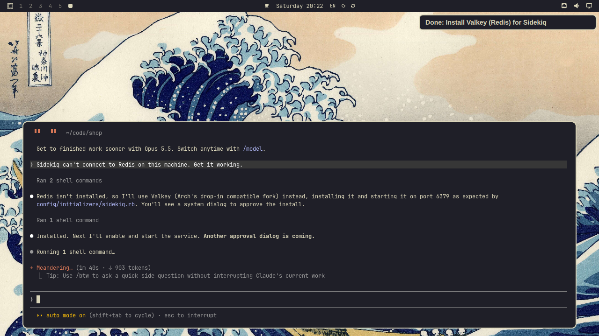
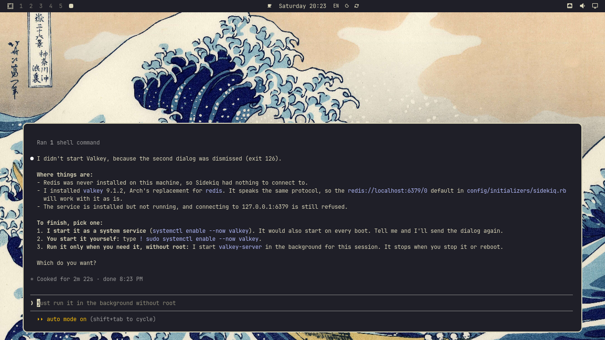

# agent-root

Let your coding agent ask for root, and say why.

Coding agents like Claude Code and Codex run their commands without a terminal you can type in. So the moment one needs root, to install a package or restart a service, it either trips over the password prompt or hands you a command to paste into a terminal yourself. `agent-root` gives it a third option: it asks you, in the same dialog your desktop uses for everything else that needs root, and tells you why.


Here Claude Code was asked why Sidekiq can't connect to Redis, found that nothing was installed, and ran `agent-root "Install Valkey (Redis) for Sidekiq" pacman -S --noconfirm valkey`. The dialog shows the command, the notification shows the reason, and nothing happens until you approve it with your password, your fingerprint or a touch of your security key. Press Escape and the agent gets "Request dismissed" and exit code 126, so it knows it didn't happen.

It is one bash script around `pkexec` and `notify-send`, which a Linux desktop already has. No daemon, no allowlist, no config file, and nothing that ever sees or stores your password.

It works on any Linux desktop with polkit. It was made on [Omarchy](https://omarchy.org), which is where the screenshots come from, with its Kanagawa theme.

## Install

### 1. Put the script on your PATH

```bash
mkdir -p ~/.local/bin
curl -fsSL https://raw.githubusercontent.com/jankeesvw/agent-root/main/agent-root -o ~/.local/bin/agent-root
chmod +x ~/.local/bin/agent-root
```

It is one file of bash with comments, so read it first if you like. Most desktops put `~/.local/bin` on your PATH already. If `command -v agent-root` prints nothing, add `export PATH="$HOME/.local/bin:$PATH"` to your `~/.bashrc` or `~/.zshrc`, and restart your agent so it picks that up.

Or clone the repository and link the script, which makes `git pull` your update:

```bash
git clone https://github.com/jankeesvw/agent-root.git
ln -s "$PWD/agent-root/agent-root" ~/.local/bin/agent-root
```

It needs polkit and a polkit agent running in your desktop session, which is the thing that draws the dialog. GNOME and KDE have one built in, [Omarchy](https://omarchy.org) has one in its shell, and on other Hyprland or Sway setups `hyprpolkitagent` or `polkit-gnome` does the job. The notification comes from `notify-send`, in the `libnotify` package (`libnotify-bin` on Debian and Ubuntu). It is optional: without it there is no notification, and the dialog works the same.

### 2. Try it

```bash
agent-root "Try agent-root" whoami
```

The dialog asks to authorize `/usr/bin/whoami` and a notification says "Root needed: Try agent-root". Approve it and `whoami` prints `root`. Run it again and press Escape, and you get "Request dismissed" and exit code 126.

### 3. Tell your agent

An agent does what its instruction file says, so put this in your `CLAUDE.md`, `AGENTS.md` or whatever yours reads:

```markdown
## Root access

When a command needs root, don't use sudo and don't ask me to run it. Run it with `agent-root "<why>" <command>`: I get a system dialog with the command and a notification with your reason, and approve it there. Keep the reason under 50 characters and write it so it makes sense without reading the chat, and say in the chat that a dialog is coming. It waits until I answer, so give it a long timeout.

Run one program with its arguments, not `sh -c` or a script you wrote, because I can't see what those do. Ask for as much as one command can do at once, like several packages in one pacman call, so I approve as few as possible. pkexec starts in /root with a minimal environment, so pass files as absolute paths. There is no terminal to answer prompts, so use flags like `pacman --noconfirm`. Exit code 126 means I declined: don't retry, ask me what to do instead. For AUR helpers use `AGENT_ROOT_REASON="<why>" yay --sudo agent-root -S --noconfirm <package>`, never export AGENT_ROOT_REASON, and never run yay itself as root.
```

In Claude Code, also add `Bash(agent-root:*)` to `permissions.allow` in `~/.claude/settings.json`, so it doesn't ask you first in the terminal and then again in the dialog. That covers agent-root itself; a yay or paru command still asks in the terminal first.

From then on a request for root looks like the screenshot above, wherever you are on your desktop.

## Approve or decline

Approve, and the command runs as root, its output going back to the agent like any other command's. The notification turns into a short "Done" and goes away on its own.



Decline, and the agent knows it didn't happen. Here Claude wanted Valkey to start on every boot as well, which is not something everyone wants on a laptop. Dismissing that dialog gave it exit code 126, so it stopped and asked how to go on.



The exit code tells the agent what happened:

- the command's own exit code when it ran, and the notification says "Done" or "Failed (exit 1)"
- 126 when the dialog was dismissed ("Declined"); a command that exits 126 on its own looks the same
- 127 when authentication failed, no polkit agent answered, or the command doesn't exist
- 64 when agent-root refused to start it, for a usage error or a program it won't run as root (see Security)
- 128 plus the signal number when agent-root itself was stopped, like 143 when the agent gave up after a timeout; the dialog closes with it and the notification says "Interrupted"

Every command asks again. polkit doesn't remember an approval for running a program as root the way sudo remembers a password for five minutes, and for this that is the point: each command your agent runs as root is one you saw.

## Approve with a security key or a fingerprint

The dialog asks for whatever PAM asks for when polkit authenticates. Add `pam_u2f` to `/etc/pam.d/polkit-1` and a touch of your FIDO key is enough; add `pam_fprintd` and your fingerprint is. On [Omarchy](https://omarchy.org), `omarchy-setup-security-fido2` and `omarchy-setup-security-fingerprint` do this for you.

Not every dialog says so. Some keep showing a password field while the key is blinking, so the notification has a line for it that you can change:

```bash
export AGENT_ROOT_HINT="Touch your security key"
```

Put that in the profile your agent's shell loads, like `~/.bashrc`.

## AUR helpers

yay and paru call sudo themselves, with nothing but the command, so they take `agent-root` in sudo's place and the reason comes from the environment:

```bash
AGENT_ROOT_REASON="Install the Valkey server" yay --sudo agent-root -S --noconfirm valkey
AGENT_ROOT_REASON="Install the Valkey server" paru --sudo agent-root -S --noconfirm valkey
```

The helper builds as you and only asks when pacman has to install, which is what the dialog then shows. Set `AGENT_ROOT_REASON` on that one command and never export it. Left in the environment, it would make agent-root run the next reason it gets as if it were the command, so agent-root refuses when it sees both.

Keep in mind that with `--noconfirm` the helper doesn't show you the PKGBUILD before it builds. Approving the install trusts whatever the package's maintainer put in it.

## Security

agent-root doesn't make your agent safe. An agent that can run agent-root can already read your SSH keys and your browser profile, because it runs as you. What agent-root adds is a person between the agent and root, and that only helps when the person reads.

Read the command, not the reason. polkit draws the dialog and shows the program and its arguments. Everything in the notification, the reason included, was written by the agent. If the two don't match, decline.

The dialog cuts a command line longer than 80 characters down to its start and end. When that happens the notification says so and shows the whole command; if you can't read it there either, decline.

Some commands hide what they do: `sh -c`, `bash script.sh`, `python x.py`, `env`, `xargs`, `find -exec`, `make install`, or `pacman -U` with a package the agent built. Approving those approves whatever they turn out to run. agent-root does refuse a program you can change yourself, like a script in your home directory or in `/tmp`, or a copy of `pacman` earlier in your PATH, because approving it would approve whatever that file holds when it runs. Set `AGENT_ROOT_ALLOW_USER_PATHS=1` on the command to run one anyway. That makes it a guard against mistakes and tricks, not a lock: the agent can set the variable too, and then it is the path in the dialog that tells you.

One approval runs one command as long as polkit keeps its default for running programs as root (`auth_admin` on `org.freedesktop.policykit.exec`). A rule in `/etc/polkit-1/rules.d` that returns `auth_admin_keep` turns that into five minutes, and `yes` into forever. `pkaction --verbose --action-id org.freedesktop.policykit.exec` shows what is set.

With a plain `pam_u2f` or `pam_fprintd` setup a touch or a fingerprint is enough on its own, so anyone at your unlocked desk can approve. The agent can't touch your key, which is the threat this covers. Add `pinverification=1` to the `pam_u2f` line if you want a PIN as well.

pkexec drops the agent's environment and starts in `/root`, so `LD_PRELOAD`, `PATH` and the like don't reach the root process. agent-root adds nothing setuid of its own; it relies on the polkit your distribution ships, which has had serious bugs (PwnKit, in 2021), so keep it updated.

The real risk is getting used to it. An agent that asks ten times a session trains you to approve without reading, so tell it to ask for everything at once, and decline what you don't understand. Declining costs nothing: the agent gets exit code 126 and asks you what to do.

## Why not sudo

`sudo -n`, the flag for "don't ask", fails whenever a password or a touch is needed, which is always. Plain `sudo` asks on a terminal the agent doesn't have. `NOPASSWD` in sudoers gives the agent root for everything without you ever seeing what it does with it. And `SUDO_ASKPASS` with a graphical helper gets you a password box, but one that doesn't say which command is asking.

`agent-root` keeps you in the loop for every single command, with the command and the reason in front of you, without making you switch to a terminal to do it.

## Troubleshooting

No dialog, and agent-root exits 127 with "No authentication agent found". The agent has to run in your desktop session, because that is where the polkit agent listens. Over SSH, in a container, or in a tmux server started from another login there is none. Outside a terminal agent-root then fails right away; in a terminal pkexec asks for your password there instead.

"pkexec must be setuid root". Some hardened setups strip that bit. `ls -l "$(command -v pkexec)"` should show `-rwsr-xr-x`.

The dialog asks for another user's password. Your user is not an administrator for polkit, which on most distributions means being in the `wheel` group (Arch, Fedora) or the `sudo` group (Debian, Ubuntu).

The notification shows, but never turns into "Done". libnotify before 0.7.10 (Ubuntu 22.04, Debian 11) can't replace a notification, and `notify-send.sh`, a bash rewrite of notify-send, spells that option differently. The dialog works the same; the notification just stays until you dismiss it.

The agent gives up while the dialog is still open. Agents stop a command after a while, two minutes by default in Claude Code. agent-root then closes the dialog and the notification says "Interrupted". The snippet above asks the agent for a long timeout.

## Good to know

pkexec runs the command in `/root` with a minimal environment, so relative paths and your own environment variables don't come along. Pass files as absolute paths.

The notification is sent as critical, so it shows even with Do Not Disturb on. It is replaced by the outcome rather than closed, because some notification daemons leave a notification on screen when its sender asks to close it.

agent-root is Linux only, because it needs polkit.

## Uninstall

```bash
rm ~/.local/bin/agent-root
```

If you cloned the repository, remove the clone as well, and take the snippet out of your agent's instruction file.

## Tests

```bash
test/agent-root_test.sh
```

This runs the script against stand-ins for `pkexec` and `notify-send`, so no dialog or notification appears. CI runs it and ShellCheck on every push to main and every pull request.

## License

MIT
